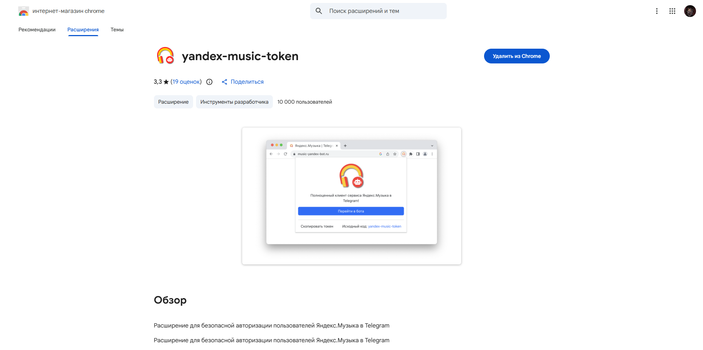
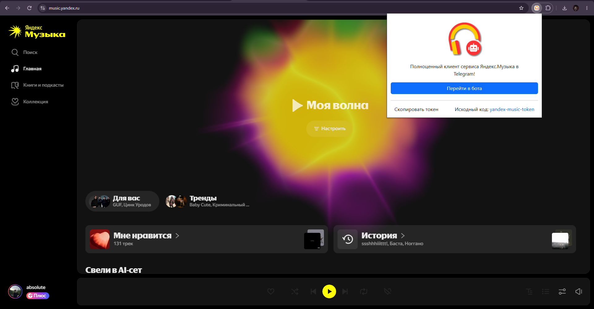
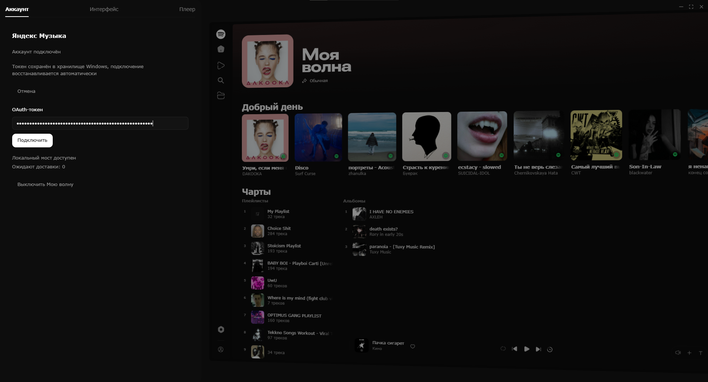

# Spotify Fork

Форк обычного Spotify с добавлением приятного интерфейса как в [Dotify](https://dotify.fun/), а так же с добавлением Моя Волна по токену Яндекс Музыки(требуется подписочка).

## Установка

1. Открой [Releases](https://github.com/absolute-christian/Spotify-fork/releases) и скачайте `MyWave-Setup.exe` из ласт релиза.
2. Запусти установщик от обычного пользователя и в конце оставьте включённой настройку приложения. Установщик при необходимости скачает Spicetify(форк спотика который дает менять дизайн), настроит Spotify и фоновый компонент(spotify перезапустится если он открыт).
3. Открой Spotify и наслаждайся интерфейсом

## Подключение токена Яндекс Музыка

1. Открой в Chrome страницу расширения [yandex-music-token](https://chromewebstore.google.com/detail/yandex-music-token/lcbjeookjibfhjjopieifgjnhlegmkib) и установи его.

   > Расширение стороннее: устанавливай и используй его на свой страх и риск, токеном можно управлять вашим аккаунтом. Владелец репозитория НЕ несет ответственность за ваши аккаунты. 

   

2. Открой [Яндекс Музыку](https://music.yandex.ru/) и войди в свой аккаунт. Нажми значок расширения вверху браузера и скопируй токен. Если значок не виден, найди расширение в меню расширений браузера.

   

3. Открой установленное приложение в Spotify и перейди в настройки, в раздел **Аккаунт**. Вставь токен в поле *«OAuth-токен** и нажми **Подключить**.

   

## Логика работы Моя Волна

При включенного режима Моя Волна форк отправляет запрос через подключенный токен к вашему аккаунту Яндекс Музыки и получает песенку из Моя Волна, когда вы слушаете - то отправляется запрос включения трека чтобы алгоритмы не сломались.
Аналогично работают так же кнопки Нравится/Не Нравится. Опять же форк отправляет запрос через токен дабы алгоритмы не путались и вы могли слушать норм музыку.

## Удаление

Удалите **My Wave for Spotify** через настройки приложений Windows. Автозапуск фонового компонента отключится, но приложение останется в конфигурации Spicetify.

Чтобы убрать его из Spicetify, выполните в PowerShell:
```powershell
spicetify config custom_apps my-wave-
spicetify apply
```
## При возникших ошибках обратитесь мне в тг - @absolute_christian
